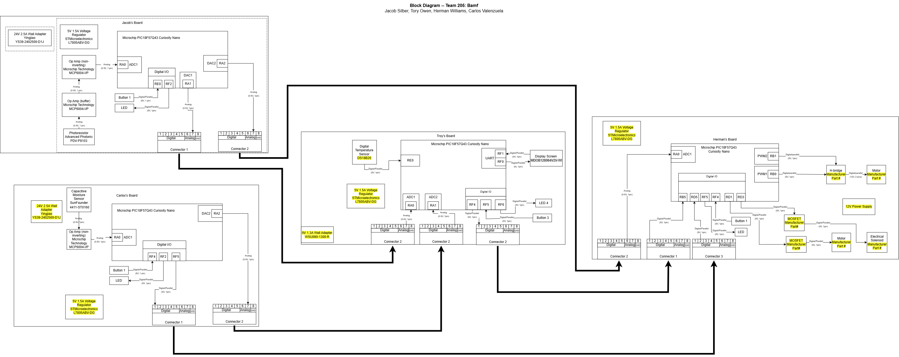

{style="width:768px;"}

Our Block Diagram was formatted in a cascading manner to illustrate the flow of communication between board, from the sensing to the display and actuation.

This diagram clearly shows 2 analog sensors for light and moisture, as well as a digital temperature sensor. Each sensor measurement communicates with the display board (2nd rightmost) to display the readings, and then the data is transmitted to the actuation board (rightmost) to move motors in accordance with measurements (water, shade, fan).

**draw.io source files:**
* [draw.io Diagram](https://drive.google.com/file/d/14Qg16k7RUVWKLrXOj7ekTo9vkqB_G_GC/view?usp=sharing)
